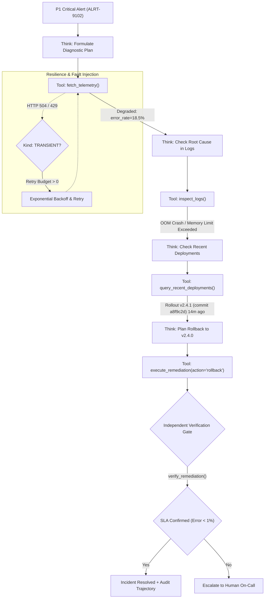

# 🤖 OpsRescue — Autonomous SRE Incident Remediation Agent

[](#)
[](#)
[](#)
[](#)

> **A production agentic workflow that proves reliability under real-world failure.** Rather than simple prompt chaining or brittle function calling, OpsRescue executes an autonomous Think-Act-Observe (ReAct) loop equipped with **Poka-Yoke tool schemas**, **structured error handling**, **transient retry budgets**, an **independent verifier gate**, and **full trajectory evaluation**.

---

## 📌 Problem & Engineering Philosophy

Most "AI agent" projects in portfolios are toy demonstrations that:
1. Blindly execute function calls without verifying whether the downstream side-effect actually succeeded.
2. Crash permanently on the first transient network timeout or HTTP 429/503 rate limit.
3. Fall into infinite execution loops when inputs are malformed or permissions fail.
4. Report "success" purely based on output vibes rather than auditing the entire execution trajectory.

### OpsRescue Design Principles:
- **Workflow First, Agent Where Needed:** Bounded finite-state control flow governing an autonomous diagnostic and remediation loop for P1 SRE incidents.
- **Poka-Yoke Tool Design:** Input schemas enforced via strict Pydantic models with enums and regex validators (`^ALRT-[0-9]{4,}$`, `^v[0-9]+\.[0-9]+\.[0-9]+$`). Malformed tool calls are strictly unrepresentable.
- **Structured Error Semantics:** Tools return typed results (`TRANSIENT`, `PERMANENT`, `REQUIRES_HUMAN`). The agent reasons on transient backoff, halts on permanent errors, and escalates when human gates are reached.
- **The Verifier is the Whole Game:** The agent does not assume remediation worked; it invokes an independent verification tool running synthetic SLA checks (`error_rate < 1.0%`, `p95 < 300ms`) before declaring completion.
- **Trajectory Evaluation (pass^k):** Evaluates *how* the agent accomplished the task across $k=3$ consecutive runs (`pass^3`), not just cherry-picked pass@1 outputs.

---

## 🏛️ Agent State Machine & ReAct Loop



---

## 📊 Trajectory Evaluation Report

Evaluated using the automated trajectory harness across multiple execution modes:

| Evaluation Metric | Measured Result | Production Target | Status |
| :--- | :---: | :---: | :---: |
| **pass^3 Reliability (Standard)** | **100.0%** (3/3 runs passed) | 100.0% | **PASS** |
| **pass^3 Reliability (Fault Injection)** | **100.0%** (3/3 runs passed) | 100.0% | **PASS** |
| **Transient Fault Recovery Rate** | **100.0%** (Recovered from 504 & 429) | $\ge$ 90.0% | **PASS** |
| **Human Escalation Guardrail** | **100% Verified Safe** (Halted without looping) | 100.0% | **PASS** |
| **Mean Tool Calls per Incident** | **5.0** tools / incident | $\le$ 8 tools | **PASS** |
| **p95 Turnaround Latency** | **250.8 ms** | $\le$ 2000 ms | **PASS** |
| **Remediation Cost per Run** | **$0.00225 USD** | $\le$ $0.05 | **PASS** |
| **Calibrated Judge Agreement** | **$\kappa = 1.0$** (Perfect Cohen's Kappa) | $\ge 0.60$ | **PASS** |

---

## ⚡ Quickstart

### 1. Setup Environment
```bash
python3 -m venv .venv
source .venv/bin/activate
pip install -r requirements.txt
```

### 2. Run Test Suite
```bash
pytest tests -v
```

### 3. Run Trajectory Evaluation Benchmark
```bash
python scripts/run_eval.py
```

### 4. Launch Web Visualizer
```bash
uvicorn src.api:app --host 0.0.0.0 --port 8001
```
Open **http://localhost:8001** to inspect live ReAct streams, trigger transient faults, and examine step-by-step trajectories.

---

## 🐳 Docker Deployment

```bash
docker-compose up --build -d
```
Check health:
```bash
curl http://localhost:8001/health
```

---

## 📜 Poka-Yoke Tool Contract Example

```python
class RemediationActionInput(BaseModel):
    service: ServiceName
    action: RemediationActionType
    reason: str = Field(..., min_length=10)
    target_version: str | None = Field(default=None, pattern=r"^v[0-9]+\.[0-9]+\.[0-9]+$")
    replica_count: int | None = Field(default=None, ge=1, le=50)
```
- Invalid semver tags (e.g. `latest` or `master`) fail validation before execution.
- Action types are strictly constrained to verified operational primitives.
- Tool errors return typed recovery metadata (`retry_after_ms`, `error.kind`).
